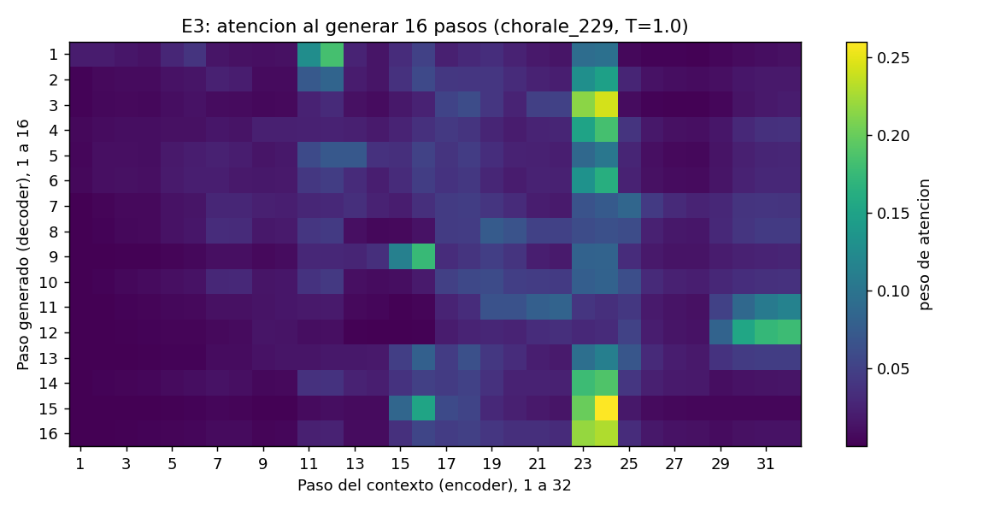

# Continuación de corales de Bach con modelos encoder-decoder

Proyecto de modelos de secuencias sobre **JSB Chorales**. A partir de 32 pasos de un coral (4 voces por paso), el modelo predice los 16 pasos siguientes. Se comparan cuatro configuraciones registradas en MLflow (E1–E4). El modelo elegido se registra en Model Registry con el alias `champion` y se sirve con FastAPI en AWS EC2.

> **Nota sobre los números.** Las cifras de este README salen de la corrida del pipeline en la EC2 del proyecto (Ubuntu 24.04, t3.large, Python 3.12, torch 2.4.1 CPU), registrada en el servidor MLflow de esa misma máquina. Los archivos de `results/` son los de esa corrida.

**Enlaces de entrega:**

- Repositorio: `https://github.com/thomasesteban22/bach-seq`
- MLflow: `http://54.198.160.150:5000`, experimento `nlp-bach-grupoG` (sin usuario ni contraseña)
- API: `http://54.198.160.150:8000/docs`

La instancia se mantiene apagada fuera de la sustentación. La IP pública puede cambiar al encenderla; en ese caso se actualizan estos enlaces.

---

## 1. Estructura

```
bach/                  paquete importable (lo usa también el modelo registrado)
  __init__.py          constantes: CONTEXT=32, HORIZON=16, 4 voces, vocabulario 128, SEED=42
  config.py            configuración por variables de entorno (sin credenciales)
  data.py              descarga, particiones, ventanas 32 -> 16, DataLoaders
  models.py            Seq2Seq (LSTM / GRU / GRU + atención aditiva) y generación por bloques
  training.py          entrenamiento, early stopping, evaluación, registro en MLflow
  runs.py              consultas a MLflow: tabla comparativa, selección, carga de checkpoints
  music.py             muestreo con temperatura, MIDI, estadísticas, mapa de atención
scripts/
  train.py             E1, E2, E3 y E4
  select_and_test.py   selección por val_loss y evaluación única en test
  generate_midi.py     dos continuaciones MIDI y mapa de atención de E3
  register_model.py    log_model + Model Registry + alias champion
  check_load.py        carga del champion desde un proceso nuevo
  api_smoke.py         prueba HTTP de la API desplegada
api/main.py            FastAPI: GET /health, POST /generate
tests/test_api.py      pytest de la API (válida, steps=33, inválidas)
ejemplos/              solicitudes JSON listas para probar /generate con curl o /docs
deploy/                servicios systemd (MLflow y API) y plantillas de configuración para EC2
DEPLOY_AWS.md          guía paso a paso de despliegue en AWS
results/               tabla, selección, curvas, MIDI, mapa de atención y salidas de pruebas
```

## 2. Datos

| Partición | Corales | Ventanas | Desplazamiento (stride) |
|---|---|---|---|
| train | 229 | 5681 | 8 |
| valid | 76 | 982 | 16 |
| test | 77 | 1011 | 16 |

- Se descarga `jsb_chorales.tgz` del repositorio de Géron y se conservan las particiones originales.
- Cada ventana tiene 48 pasos de un mismo coral: 32 de contexto (X) y 16 de objetivo (Y). Ninguna ventana cruza el límite entre dos corales. Si al final de un coral no caben 48 pasos, ese resto se descarta.
- Vocabulario fijo de 0 a 127 (alturas MIDI) sin recodificar. El 0 significa silencio y se trata como una clase más: entra en la pérdida y en las métricas.

## 3. Modelos

Las tres arquitecturas comparten las mismas decisiones de diseño:

- **Entrada por paso:** cada una de las 4 notas pasa por una tabla de embeddings de 16 dimensiones. La tabla es compartida entre voces, así la nota 60 es el mismo tono en cualquier voz. Los 4 vectores se concatenan en el orden note0..note3, y la entrada de la red en cada paso mide 64.
- **Encoder:** lee los 32 pasos. Su estado final inicializa el decoder; en LSTM se pasan `h` y `c`.
- **Decoder con teacher forcing:** recibe como primera entrada el último paso de X y después y₁..y₁₅, es decir, el paso real anterior.
- **Salida:** una capa lineal de 128 → 4×128 produce logits de forma `(batch, 16, 4, 128)`.
- **Pérdida:** `CrossEntropyLoss` sobre los logits reorganizados a `(batch·16·4, 128)`, sin softmax previo.

| Run | Arquitectura |
|---|---|
| E1 | Encoder-decoder LSTM |
| E2 | Encoder-decoder GRU |
| E3 | Encoder-decoder GRU con atención aditiva (Bahdanau) |
| E4 | Arquitectura de E2 (la de menor val_loss entre E1–E3) con `hidden` = 256 |

**Atención (E3).** En cada paso, el estado del decoder `s` se compara con las 32 salidas del encoder `hᵢ` mediante `score = vᵀ tanh(W_q s + W_k hᵢ)`. Un softmax sobre los 32 scores produce los pesos α. El vector de contexto es `Σ αᵢ hᵢ` y se concatena al embedding del paso que entra al decoder.

**Protocolo común:**

- hidden 128, embedding 16, 1 capa.
- Adam con lr 1e-3, lotes de 64, máximo 20 épocas.
- Semilla 42 reiniciada al comienzo de cada run.
- Early stopping con paciencia 4 sobre la pérdida de validación.
- Las exactitudes se calculan recargando el **mejor checkpoint**, no el de la última época.
  - **Exactitud por nota:** fracción de las 16×4 notas en que el argmax coincide con la nota real.
  - **Exactitud por paso:** fracción de pasos en que aciertan las 4 voces a la vez.

## 4. Registro en MLflow

- **Experimento:** `MLFLOW_EXPERIMENT` (por defecto `nlp-bach-grupoG`). Runs `E1`, `E2`, `E3` y `E4`.
- **Parámetros:**
  - architecture, cell, attention, attention_type, layers, hidden_dim, embedding_dim, embedding_combination
  - learning_rate, batch_size, max_epochs, patience, seed, optimizer
  - context, horizon, strides y número de ventanas
- **Métricas:**
  - `train_loss` y `val_loss` por época.
  - `best_epoch`, `best_val_loss`, `val_note_acc`, `val_step_acc` (del mejor checkpoint), `trainable_params`, `train_time_s`, `epochs_run`.
  - En el run elegido, además, `test_loss`, `test_note_acc` y `test_step_acc`.
- **Etiquetas:**
  - `lab_id`, `device`.
  - E4: `base_run`, `changed_param`, `changed_from`, `changed_to`.
  - Run elegido: `selected=true`.
- **Artefactos:**
  - `config.json`, `loss_curve.png`, `resources.json` (parámetros, tiempo, dispositivo, versión de torch) y `checkpoint/best_checkpoint.pt`.
  - E3: `attention/` con el mapa de atención.
  - Run elegido: `generation/` (MIDI, CSV y reporte) y `model/` (modelo registrado).

## 5. Resultados de validación (E1–E4)

| Run | Celda | Atención | Oculta | Mejor época | Val loss | Val acc nota | Val acc paso | Parámetros | Tiempo (s) |
|---|---|---|---|---|---|---|---|---|---|
| E1 | LSTM | No | 128 | 20 | 0.7490 | 0.7904 | 0.5999 | 266 752 | 85 |
| E2 | GRU | No | 128 | 19 | 0.6339 | 0.8158 | 0.6380 | 217 088 | 77 |
| E3 | GRU | Sí | 128 | 19 | 0.7311 | 0.7909 | 0.6040 | 299 393 | 187 |
| **E4** | GRU | No | **256** | 12 | **0.6057** | **0.8217** | **0.6451** | 628 224 | 123 |

Dispositivo: CPU. Las curvas de pérdida están en `results/curves/` y en cada run de MLflow.

**Lectura de la tabla:**

- **E1 vs. E2.** El GRU logra menor pérdida que el LSTM (0.634 frente a 0.749) con menos parámetros. Las dos curvas seguían bajando en la época 20, así que con 20 épocas el LSTM, más lento de optimizar, quedó más atrás.
- **E3 (atención) no mejora a E2.** En validación con teacher forcing, el decoder ya ve el paso real anterior, y en estos corales ese paso es muy informativo: aproximadamente el 75 % de los pasos repite el acorde anterior. La atención agrega parámetros y una entrada de 128 dimensiones más al decoder. Desde la época 13, la validación casi no mejora (0.745 → 0.731), mientras el entrenamiento sigue bajando (0.665 → 0.540), y en la época 20 la validación vuelve a subir (0.741): tiende a sobreajustar antes.
- **Exactitud por paso.** Siempre es bastante menor que la exactitud por nota, porque exige acertar las 4 voces a la vez.
- **Tamaño de los modelos.** Los modelos no tienen el mismo número de parámetros, y eso pesa en la comparación. E2 (217 088) es el más pequeño y aun así supera a E1 (266 752). E3 suma unos 82 mil parámetros sobre E2 (299 393) sin mejorar. E4 casi triplica a E2 (628 224), así que su mejora es, al menos en parte, efecto de la mayor capacidad y no de un cambio de arquitectura.
- **Alcance de la comparación.** Cada configuración se entrenó una sola vez, con la semilla 42. Eso hace que las ejecuciones sean comparables entre sí, pero no demuestra que una arquitectura sea mejor en general. Con otra semilla, otro presupuesto de épocas u otros datos, el orden podría cambiar, sobre todo entre modelos con pérdidas cercanas.

### Justificación de E4

E2 tuvo la menor pérdida de validación entre E1 y E3, así que E4 reentrena **la misma arquitectura desde cero** cambiando **un solo hiperparámetro: la dimensión oculta, de 128 a 256**. Todo lo demás queda igual: semilla, lr, lotes, embeddings, épocas y paciencia.

El cambio se justifica por la curva de E2. Su mejor época fue la 19 de 20, y la pérdida de entrenamiento (0.526) seguía cerca de la de validación (0.634). El modelo no había llegado a sobreajustar y seguía aprendiendo, lo que indica que había espacio para más capacidad.

Resultado: E4 baja la pérdida de validación a **0.6057** y llega a su mejor punto en la época 12. Después la validación sube mientras el entrenamiento sigue bajando, y el early stopping lo detiene en la época 16. La mayor capacidad aprende más rápido, pero también empieza a sobreajustar antes.

## 6. Modelo elegido y resultado en test

Criterio: **menor pérdida de validación** (`best_val_loss`). El elegido es **E4** (GRU, hidden 256). Solo este modelo se evaluó en test, una sola vez (`scripts/select_and_test.py`), y las métricas quedaron registradas en su run.

| Modelo | Val loss | Test loss | Test acc nota | Test acc paso | Ventanas de test |
|---|---|---|---|---|---|
| E4 | 0.6057 | **0.6256** | **0.8157** | **0.6268** | 1011 |

La pérdida de test es solo 0.02 mayor que la de validación. No se usó test para tomar ninguna decisión.

## 7. Generación musical

- **Modelo:** E4 (champion).
- **Contextos:** primeros 32 pasos de dos corales distintos de valid, `chorale_229` (índice 0) y `chorale_269` (índice 40).
- **Pasos generados:** 32 por coral, en 2 bloques de 16 y **sin teacher forcing**. Al terminar cada bloque, los últimos 32 pasos disponibles se vuelven a codificar con el encoder y el decoder se reinicia con ese estado.
- **Muestreo:** cada nota se toma de `softmax(logits / T)` con **T = 1.0**. Semilla de muestreo **42** para `chorale_229` y **43** para `chorale_269`.
- **MIDI:** `pretty_midi`, archivo = contexto + continuación (64 pasos). Detalles:
  - Una pista por voz, programa 52 (Choir Aahs).
  - Tempo de **80 negras por minuto**. Cada paso equivale a una semicorchea, es decir, 60/(4·80) = 0.1875 s.
  - Notas consecutivas iguales dentro de una voz se **fusionan** en una nota larga, porque la matriz no distingue una nota sostenida de una repetida.
  - El 0 se escribe como silencio, sin nota.
- **Archivos:** `results/generation/chorale_229_continuacion.mid` y `chorale_269_continuacion.mid`, con sus CSV y `generation_report.json`. Los mismos archivos están en el run elegido, en `generation/`.

### Análisis de las continuaciones

Comparación entre los 32 pasos generados y los 32 pasos reales que siguen en el mismo coral:

| | Silencios | Pasos iguales al anterior | Acordes distintos | Notas distintas (S, A, T, B) |
|---|---|---|---|---|
| chorale_229 generado | 0 % | 48.4 % | 17 | 5, 5, 7, 4 |
| chorale_229 original | 0 % | 74.2 % | 9 | 3, 3, 6, 6 |
| chorale_269 generado | 0 % | 58.1 % | 13 | 5, 4, 5, 4 |
| chorale_269 original | 0 % | 77.4 % | 8 | 4, 2, 4, 6 |

- **Repeticiones.** El modelo aprendió que los acordes se sostienen: la mayoría aparece en grupos de 2 o 4 pasos iguales (negras y blancas), como en el original. Aun así, repite **menos** que Bach (48–58 % frente a 74–77 %), así que cambia de acorde más seguido. No aparecen bucles: ningún acorde dura más de 4 pasos seguidos y no se repite ninguna frase completa.
- **Variedad.** Hay casi el doble de acordes distintos que en el original (13–17 frente a 8–9). Parte de esa variedad es musical y parte son errores:
  - **Lo musical.** El bajo se mueve por grados conjuntos (53 → 50 → 47 → 52 → 50 en `chorale_229`). La soprano dibuja una línea con sentido (74 → 71 → 72 → 74 → 76 → 74 → 69).
  - **Los errores.** Hay notas que duran **un solo paso** en una voz y desaparecen, algo raro en un coral: el tenor 59 en el paso 5 y el 65 en el paso 9 de `chorale_269`, o la contralto 71 en el paso 25. También aparecen alteraciones ajenas al contexto: la soprano 75 (Mi bemol) en `chorale_269`, o el Do# (61) y el Fa# (66) en `chorale_229`.

  Esto se explica porque cada nota se muestrea con T = 1.0, sin quedarse siempre con la más probable, y porque las 4 voces de un paso se muestrean de forma independiente.
- **Silencios.** No se generó ningún 0. Es coherente con los datos: los silencios son muy raros en el dataset y el modelo les asigna muy poca probabilidad.
- **Registro.** Cada voz se mantiene en su registro: soprano 69–76, contralto 61–71, tenor 57–66, bajo 47–55. El segundo bloque, que se genera después de re-codificar el contexto, sigue la continuidad del primero sin saltos bruscos.

**Desempeño predictivo frente a calidad musical.** Las dos cosas se miden de forma distinta y no deben confundirse:

- La pérdida y las exactitudes de las secciones 5 y 6 miden qué tan bien predice el modelo el paso siguiente **con teacher forcing**, es decir, viendo siempre el paso real anterior.
- En la generación libre, cada paso depende de las notas que el propio modelo muestreó, así que los errores se acumulan. Además, con T = 1.0 no se elige la nota más probable.
- Por eso una exactitud por nota de 0.82 no garantiza una continuación que suene bien. Las estadísticas de esta sección (repeticiones, variedad, silencios) describen la salida, pero no miden su calidad percibida, que solo se puede juzgar escuchando los MIDI.

### Mapa de atención de E3



El mapa muestra los pesos α al generar 16 pasos libres a partir del contexto de `chorale_229` (semilla 42, T = 1.0). Filas: paso generado (1 a 16). Columnas: paso del contexto (1 a 32).

- **La atención no es uniforme ni solo se fija en lo reciente.** Con pesos uniformes, cada paso recibiría 1/32 ≈ 0.031. El peso máximo promedio por fila es 0.119, casi 4 veces más. Los últimos 8 pasos del contexto reciben el 27.9 % del peso total, apenas por encima del 25 % que les tocaría con pesos uniformes.
- **Se concentra en bloques de 2 pasos.** En 9 de las 16 filas, las dos columnas con más peso son pasos vecinos que forman un mismo acorde: 11–12 (filas 1–3), 23–24 (filas 4, 6, 11 y 14) y 31–32 (filas 13 y 15). Esos bloques coinciden con la duración de los acordes del coral, que en el contexto casi siempre dura 2 o 4 pasos: el modelo atiende al acorde completo, no a un paso suelto.
- **Los acordes elegidos son puntos de llegada de la línea del bajo.** El contexto tiene un bajo que sube por grados: 48 → 50 → 52 → **53** (pasos 11–12) y luego 45 → 47 → 48 → **50** (pasos 23–24). La atención se fija justo en esos acordes, `[72, 67, 64, 53]` y `[69, 65, 60, 50]`, y en el acorde final del contexto, `[72, 64, 60, 57]` (pasos 29–32).
- **El patrón cambia a lo largo del bloque.** Las primeras filas miran sobre todo al acorde de los pasos 11–12. Desde la fila 4 el peso pasa a 23–24, en las filas 7–9 aparece también el paso 16, y en la segunda mitad del bloque la atención se mueve hacia el final del contexto: en las filas 13 y 15, los pasos 25–32 reciben más del 50 % del peso.

Este análisis describe **un** ejemplo y no prueba una regla general. Además, E3 tuvo peor pérdida que E2, así que la atención no se tradujo en mejores predicciones con este presupuesto de épocas.

## 8. Model Registry y verificación de carga

`scripts/register_model.py` hace lo siguiente:

- Restaura los pesos del mejor checkpoint de E4.
- Ejecuta `mlflow.pytorch.log_model` **dentro del mismo run de entrenamiento**, de modo que la versión queda vinculada a ese `run_id`.
- Usa `code_paths=["bach"]`, para que `Seq2Seq`, con su método `generate`, se pueda importar al cargar el modelo. Si la versión de MLflow ofrece `serialization_format`, usa `"pickle"`; MLflow 2.16 no ofrece ese parámetro y guarda el objeto completo con pickle por defecto.
- Registra el modelo con el nombre `MODEL_NAME` (por defecto `bach-chorales-grupoG`) y le asigna el alias `champion`.

Verificación desde otro proceso, fuera de la carpeta del repo, con `MLFLOW_TRACKING_URI` apuntando al servidor. El script resuelve `champion` a un número de versión y carga `models:/<nombre>/<versión>`, no un archivo local:

```
$ cd /tmp && python ~/bach-seq/scripts/check_load.py
Cargado bach-chorales-grupoG v1 (run 1e255a87c0714723b9407ce981ab320f) [bach.models.Seq2Seq]; generado (33, 4), rango 38-69
```

El rango de notas cambia en cada ejecución porque la generación de prueba muestrea con T = 1.0.

## 9. API

```bash
# variables en el entorno (en EC2 vienen de /etc/bach-api.env)
uvicorn api.main:app --host 0.0.0.0 --port 8000
```

Al arrancar, la API resuelve `champion` a un número de versión y carga `models:/<MODEL_NAME>/<versión>` en CPU. Las solicitudes no vuelven a consultar MLflow; si cambia el alias, se reinicia el servicio.

- **`GET /health`** responde `{"status": "ok", "model": "bach-chorales-grupoG", "version": "1"}`.
- **`POST /generate`**
  - Recibe:
    - `seed`: exactamente 32 pasos × 4 enteros entre 0 y 127, en el orden de voces del CSV.
    - `steps`: entero entre 1 y 64.
    - `temperature`: opcional, entre 0.5 y 1.5, por defecto 1.0.
  - Responde `generated` (steps × 4, sin el contexto), `model` y `version` (string).
  - Una entrada inválida se rechaza con **422** por la validación de pydantic, antes de llegar al modelo. Casos rechazados: forma distinta de 32×4, notas fuera de rango o no enteras, `steps` fuera de 1–64, temperatura fuera de rango o falta de `seed`.

Ejemplo de solicitud, armando `seed` desde un coral:

```python
import httpx, pandas as pd
coro = pd.read_csv("data/jsb_chorales/valid/chorale_229.csv")
payload = {"seed": coro[["note0", "note1", "note2", "note3"]].iloc[:32].values.tolist(),
           "steps": 32, "temperature": 1.0}
r = httpx.post("http://54.198.160.150:8000/generate", json=payload, timeout=60)
print(r.status_code, len(r.json()["generated"]), r.json()["model"], r.json()["version"])
```

Sin Python, la carpeta `ejemplos/` trae solicitudes listas, con los primeros 32 pasos de `chorale_229` como contexto. Se envían con `curl` (en Windows, desde CMD dentro del repo):

```bash
curl -X POST http://54.198.160.150:8000/generate -H "Content-Type: application/json" -d @ejemplos/valida_16.json
```

| Archivo | Caso | Respuesta esperada |
|---|---|---|
| `valida_16.json` | válida, 16 pasos, T = 1.0 | `200`, `generated` de 16×4 |
| `valida_33.json` | `steps=33`, sin `temperature` (usa 1.0) | `200`, `generated` de 33×4 |
| `invalida_nota_200.json` | una nota fuera de 0–127 | `422` |
| `invalida_31_pasos.json` | `seed` con 31 pasos | `422` |
| `invalida_steps_65.json` | `steps` mayor que 64 | `422` |

El mismo contenido se puede pegar en `/docs` → `POST /generate` → *Try it out*.

### Pruebas

`pytest -v tests/test_api.py` usa el modelo champion real. Cubre:

- `/health`
- una petición válida, verificando longitud y rango de las notas
- `steps=33`, que obliga a 3 bloques (16 + 16 + 1)
- 9 entradas inválidas, verificando además que el modelo **no** se llamó

Resultado: `12 passed` (`results/pytest_api.txt`).

`python scripts/api_smoke.py http://<IP>:8000` prueba la API por HTTP (`results/api_smoke.txt`):

```
GET /health                -> 200  {'status': 'ok', 'model': 'bach-chorales-grupoG', 'version': '1'}
valida, steps=16           -> 200  generated 16x4, primeros 2: [[74, 70, 65, 50], [74, 70, 65, 50]], model=bach-chorales-grupoG, version='1'
steps=33                   -> 200  generated 33x4, primeros 2: [[74, 69, 65, 58], [74, 69, 65, 58]], model=bach-chorales-grupoG, version='1'
invalida: nota 200         -> 422  less_than_equal en ['body', 'seed', 0, 0]: Input should be less than or equal to 127
invalida: 31 pasos         -> 422  too_short en ['body', 'seed']: List should have at least 32 items after validation, not 31
invalida: steps=65         -> 422  less_than_equal en ['body', 'steps']: Input should be less than or equal to 64
invalida: temperature=2    -> 422  less_than_equal en ['body', 'temperature']: Input should be less than or equal to 1.5
```

## 10. Instalación y ejecución

El despliegue completo en AWS (EC2, servidor MLflow, servicios systemd, security group e IP elástica) está en **[DEPLOY_AWS.md](DEPLOY_AWS.md)**. Resumen de los comandos:

```bash
python3 -m venv .venv && source .venv/bin/activate
pip install torch==2.4.1 --index-url https://download.pytorch.org/whl/cpu   # en máquinas sin GPU
pip install -r requirements.txt
cp .env.example .env && chmod 600 .env     # completar; .env está en .gitignore
set -a && source .env && set +a

python scripts/train.py                 # E1, E2, E3 y E4 (E4 = mejor de E1-E3 con hidden 256)
python scripts/select_and_test.py       # selección por val_loss + test una sola vez
python scripts/generate_midi.py         # MIDI + mapa de atención de E3
python scripts/register_model.py        # Model Registry + alias champion
(cd /tmp && python ~/bach-seq/scripts/check_load.py)   # carga desde otro proceso
uvicorn api.main:app --host 0.0.0.0 --port 8000
pytest -v tests/test_api.py
```

## Seguridad

- El repositorio no contiene claves, tokens ni contraseñas. La URL de MLflow, el experimento y el nombre del modelo se leen de variables de entorno (`~/bach-seq/.env` y `/etc/bach-api.env` en la EC2, ambos fuera de git).
- **Ni el servidor MLflow ni la API tienen autenticación.** La práctica no la exige, y así el docente puede consultar MLflow y probar la API sin credenciales. El security group abre los puertos 5000 y 8000 a cualquier IPv4 para que pueda entrar desde cualquier red.
- La contrapartida es que, mientras la instancia está encendida, cualquiera que conozca la IP podría modificar o borrar runs y modelos en MLflow. Para limitar ese riesgo, **la instancia se mantiene apagada** fuera de las sesiones de trabajo y de la sustentación.
- La llave SSH (`.pem`) queda solo en los equipos del grupo. `.gitignore` excluye `.env`, `*.pem`, `*.key`, datos, `mlruns/` y `mlflow.db`.

## Declaración de uso de herramientas de IA

Este laboratorio se hizo en **colaboración híbrida entre el grupo G y Claude (Anthropic)**, un asistente de IA generativa. El grupo dirigió el trabajo y la IA ejecutó buena parte de la implementación, siempre a partir de la guía del laboratorio y de las decisiones del grupo.

**Lo que hizo el grupo:**

- Definir el alcance a partir de la guía del laboratorio y decidir qué entregar.
- Crear el repositorio en GitHub y la instancia EC2 en AWS Academy, y configurar su security group.
- Decidir cómo exponer los servicios: puertos 5000 y 8000 abiertos, MLflow sin autenticación y la instancia apagada fuera de la sustentación.
- Dirigir cada etapa, pedir correcciones y comparar el resultado con la guía.
- Probar la API desde sus propios equipos y preparar la sustentación.

**Lo que hizo la IA:**

- Escribir el código del paquete `bach/`, los scripts, la API y las pruebas.
- Redactar la guía de despliegue y este README.
- Ejecutar el despliegue en la EC2 por SSH: instalación, servidor MLflow con autenticación, entrenamiento E1–E4, selección, generación, registro del modelo y servicio de la API.
- Llevar los resultados reales al repositorio y verificar las cifras del README contra los registros de MLflow.

**Criterios que se siguieron:**

- Todas las cifras de este README salen de la corrida registrada en MLflow, no de valores escritos a mano.
- Los modelos se entrenaron desde cero con los datos del laboratorio. No se usó ningún servicio externo de generación musical ni modelos preentrenados.
- El repositorio no contiene llaves, tokens ni contraseñas.

El grupo es responsable del contenido entregado y debe poder explicar el código, los resultados y las decisiones durante la sustentación.
